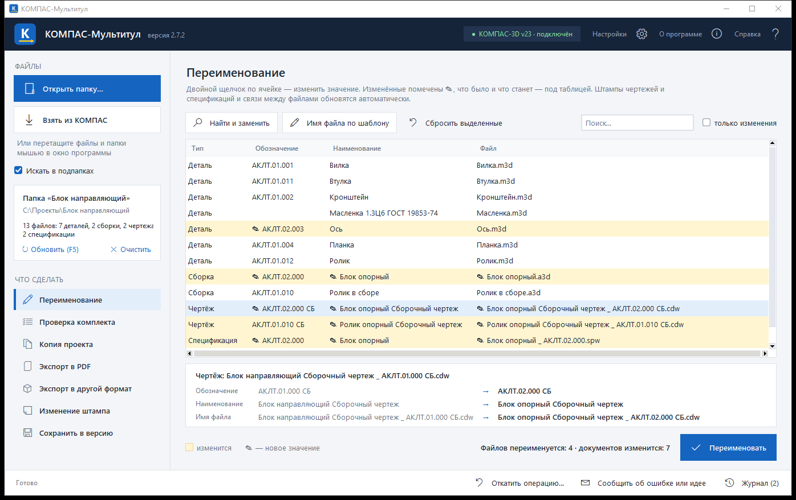
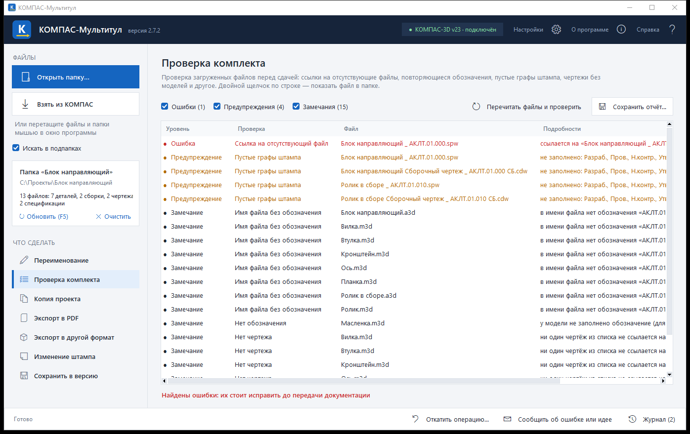
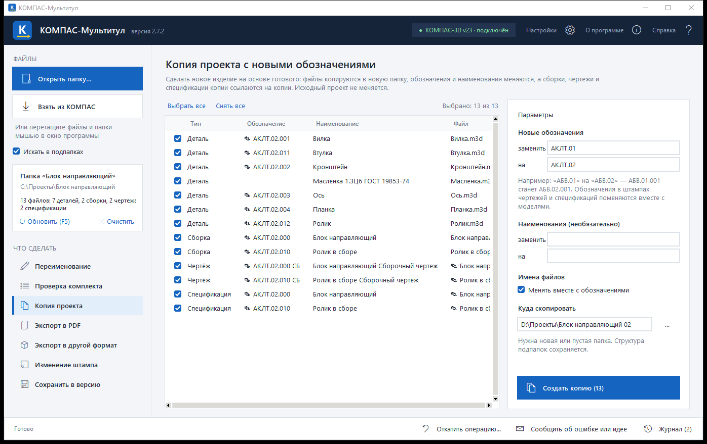
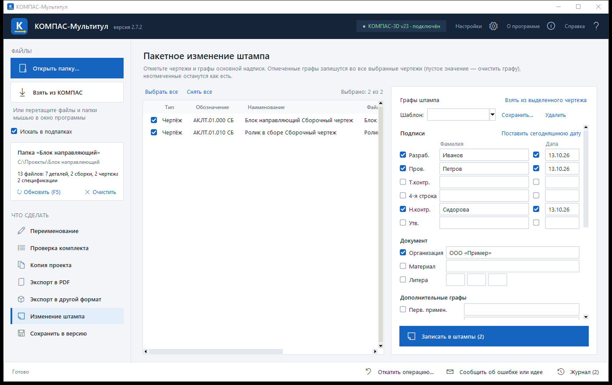
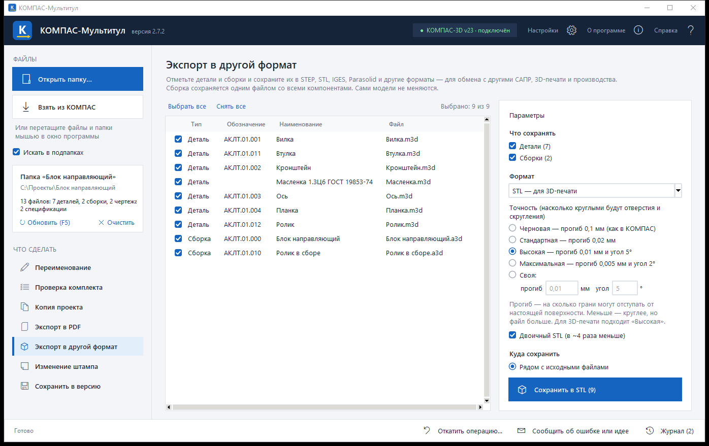

# КОМПАС-Мультитул

Бесплатный набор инструментов для пакетной работы с документами **КОМПАС-3D**: переименование с сохранением связей, проверка комплекта, копия проекта, изменение штампа, экспорт в PDF, STEP, STL и другие форматы.

**[⬇ Скачать последнюю версию](https://github.com/maybedance/kompas-multitool/releases/latest)** · Windows 10/11 · нужен установленный КОМПАС-3D · бесплатно

## Что умеет

### Переименование с сохранением связей
Меняет обозначения и наименования прямо в моделях и в штампах чертежей и спецификаций, переименовывает файлы и сама перепривязывает компоненты в сборках, виды в чертежах и документы в спецификациях, включая подсборки. Если поменять обозначение модели, оно само подставится в штамп её чертежа, спецификации и в имена файлов: «Корпус _ АБВ.01.000 СБ.cdw» → «Корпус _ АБВ.02.000 СБ.cdw». Есть «Найти и заменить» (в том числе с регулярными выражениями) и имена файлов по шаблону, например `{обозначение} _ {наименование}`.

### Проверка комплекта
Одной кнопкой — список проблем перед сдачей документации: ссылки на отсутствующие файлы, повторяющиеся обозначения, пустые «Разраб.» и «Н.контр.» в штампах, обозначение чертежа не совпадает с моделью, модели без чертежей и чертежи без моделей. Отчёт сохраняется для Excel.

### Копия проекта с новыми обозначениями
Новое изделие на основе готового: файлы копируются в новую папку, обозначения меняются по замене (например, «АБВ.01» → «АБВ.02»), имена файлов — вместе с ними, а сборки, чертежи и спецификации копии ссылаются на копии. Исходный проект не меняется.

### Изменение штампа чертежей
Пакетно вписывает в основную надпись выбранных чертежей фамилии и даты (Разраб., Пров., Т.контр., Н.контр., Утв.), организацию, материал, литеру, инвентарные номера и строку таблицы изменений. Отмеченная графа записывается во все чертежи, пустое значение очищает графу, неотмеченные не трогаются. Графы можно взять из чертежа-образца, а наборы фамилий сохранить как шаблоны — например, для каждого отдела.

### Экспорт в PDF
Чертежи и спецификации — пачкой, рядом с исходниками или в одну папку, с именами как у документов или по шаблону. Можно сразу собрать всё в один PDF-комплект.

### Экспорт в STEP, STL и другие форматы
Детали и сборки — в STEP (AP214, AP242, AP203), STL, IGES, Parasolid, ACIS, JT, VRML, C3D. Для STL задаётся точность: если отверстия на 3D-печати выходят многогранными, выберите «Высокую» — по умолчанию КОМПАС сохраняет STL слишком грубо. STL сохраняется в двоичном виде, файлы в несколько раз меньше.

### Сохранение в более раннюю версию КОМПАС
Для тех, у кого стоит версия постарше: копии сохраняются в отдельную папку и перепривязываются друг к другу, так что сборка в старой версии открывается со своими деталями.

### И ещё
- **Взять из КОМПАС** — программа забирает открытую сборку со всеми деталями, подсборками, чертежами и спецификациями (стандартные изделия не трогает).
- Файлы и папки можно просто **перетащить мышью** в окно.
- Если нужные документы открыты в КОМПАС, программа предложит закрыть их сама — с сохранением изменений.
- Сама сообщает о выходе новой версии.

## Установка

1. Скачайте архив `KOMPAS_Multitool_…zip` со страницы **[последней версии](https://github.com/maybedance/kompas-multitool/releases/latest)**.
2. Распакуйте в любую папку и запустите `KOMPAS_Multitool.exe`. Устанавливать ничего не нужно.
3. При первом запуске прочитайте и примите лицензионное соглашение.

Чтобы обновиться, замените старый exe новым — настройки и шаблоны сохранятся.

## Как пользоваться

1. **Выберите файлы** — «Открыть папку…», «Взять из КОМПАС» или перетащите их в окно.
2. **Выберите, что сделать** — в меню слева.
3. **Задайте параметры и нажмите кнопку** внизу справа. В конце программа покажет итог и предложит открыть папку с результатом.

Подсказки есть прямо в окне, подробнее — в «Справке» (вверху справа).

## Безопасность

- Перед переименованием, изменением штампа и заменой файлов программа сохраняет исходные версии в папку `_KOMPAS_Multitool_backup_ДАТА` внутри проекта. Кнопка **«Откатить операцию…»** возвращает всё как было.
- Все изменения делает сам КОМПАС через свой штатный программный интерфейс — программа не правит файлы «вручную».
- Программа ничего не отправляет в интернет. Единственное обращение к сети — раз в сутки она узнаёт на GitHub номер последней версии; это можно отключить в «Настройках».
- Перед первой большой операцией всё же попробуйте программу на копии проекта.

## Требования и совместимость

- Windows 10 или 11, 64-бит.
- Установленный КОМПАС-3D с рабочей лицензией. Если КОМПАС уже открыт, программа работает через него; если нет — запускает его невидимо, когда понадобится.
- **Проверено на КОМПАС-3D v23.** На других версиях должна работать, но пока не проверена — если попробуете, напишите, пожалуйста, получилось или нет.

## Частые вопросы

**Windows пишет «Защитник Windows предотвратил запуск неопознанного приложения».**
У программы нет платной цифровой подписи, поэтому Windows её «не знает». Нажмите «Подробнее» → «Выполнить в любом случае». Некоторые антивирусы так же насторожённо относятся к небольшим программам без подписи.

**Программа пишет, что документы открыты в КОМПАС.**
Открытые документы изменить нельзя. Нажмите «Закрыть в КОМПАС» — программа закроет их сама (с сохранением изменений) и продолжит. В «Настройках» можно включить закрытие без вопросов.

**У нас сетевая лицензия.**
В режиме «Автоматически» программа работает через уже открытый КОМПАС и второе место лицензии не занимает. Если КОМПАС закрыт, она запустит невидимый — он займёт место, пока открыта программа.

**Переименовал файлы, а в другой папке осталась сборка со старыми ссылками.**
Программа обновляет только документы из списка. Загружайте сразу всю папку изделия или берите сборку через «Взять из КОМПАС».

## Обратная связь

Нашли ошибку или есть идея, что добавить, — в раздел [Issues](https://github.com/maybedance/kompas-multitool/issues).

Если программа показала ошибку, нажмите в её окне «Скопировать для автора» — в сообщение попадут версии программы, КОМПАС и Windows и последние строки журнала, по ним проще разобраться.

## Условия использования

© 2026 maybedance. Программа **бесплатная**: пользоваться можно на любом количестве компьютеров, в том числе в работе организации, и свободно распространять — бесплатно, без изменений и со сведениями об авторе. **Продавать программу или выдавать за свою запрещено.** Полные условия — в лицензионном соглашении, которое лежит в архиве и показывается при первом запуске.

КОМПАС-3D — товарный знак ООО «АСКОН». Программа не связана с компанией АСКОН и работает через штатный программный интерфейс установленного КОМПАС-3D.
